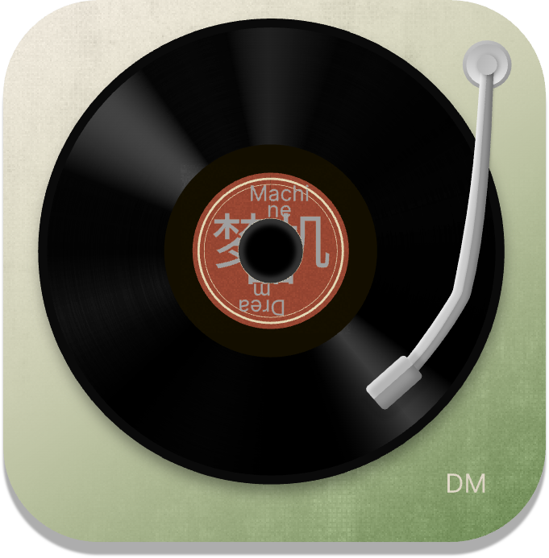
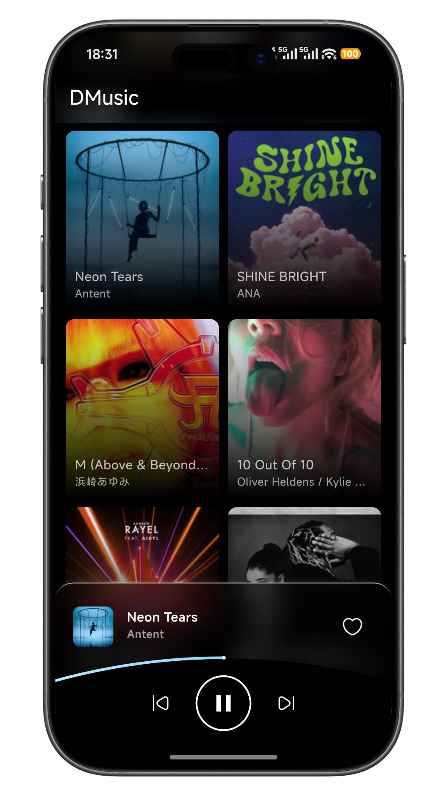
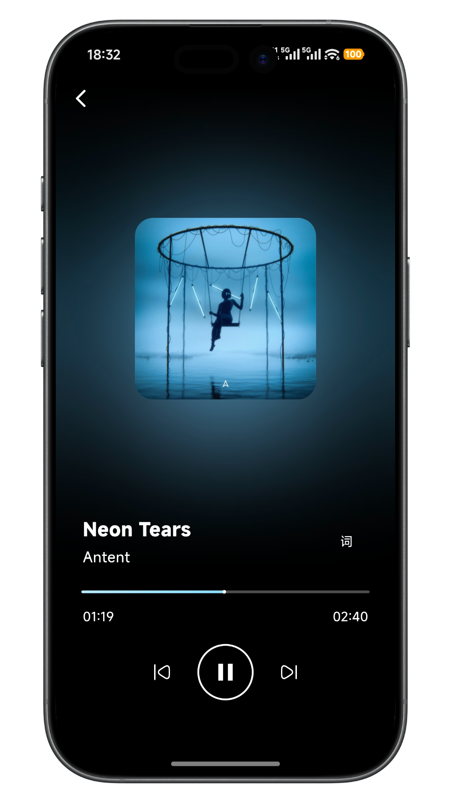

# DM Music

<p align="center">
  
</p>

<p align="center">
  Flutter 开发的音乐 App · 沉浸式全屏播放 · 边听边缓存
</p>

## 预览

| 首页 | 播放页 |
| :--: | :--: |
|  |  |

## 功能特性

- **首页推荐** — 新歌、流行歌曲与网易云推荐歌单，点击即播
- **全屏播放页** — 封面氛围模糊背景、进度拖拽与完整的播放控制
- **边听边缓存** — 基于 `LockCachingAudioSource`，缓存命中后断网也能播放
- **本地收藏** — 喜欢的歌曲用 `shared_preferences` 持久化，重启不丢失
- **离线兜底** — 网络异常时保留上一次成功加载的数据，配有加载 / 空 / 错误三态
- **深浅主题** — 统一主题配置，支持明亮 / 暗色切换
- **iOS 风格交互** — 全局返回按钮、透明 AppBar 与沉浸式状态栏

## 技术栈

| 分类 | 依赖 |
| :-- | :-- |
| 框架 | Flutter 3 · Dart 3 |
| 路由 / 状态 | go_router · flutter_riverpod |
| UI | material_ui · hugeicons · animate_do |
| 网络 / 图片 | dio · cached_network_image |
| 数据加密 | pointycastle（网易云 weapi 参数加密） |
| 音频播放 | just_audio |
| 本地存储 | shared_preferences |

## 快速开始

环境要求：Flutter SDK `^3.14.0`。

```bash
flutter pub get      # 获取依赖
flutter run          # 运行
```

构建发布包：

```bash
flutter build apk --release       # Android
flutter build ios --release       # iOS
```

## 项目结构

```
lib/
├── app/          # 应用入口、路由、全局主题
├── core/         # 音频播放、收藏、网络（weapi）、数据模型
├── modules/      # 业务页面：home / play / splash
└── shared/       # 通用组件：三态视图、模糊层、进度条等
```
